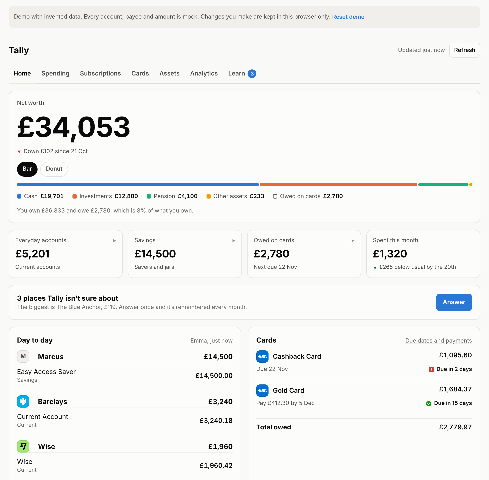
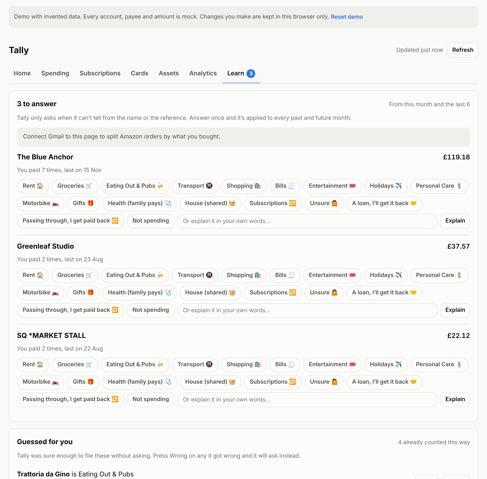
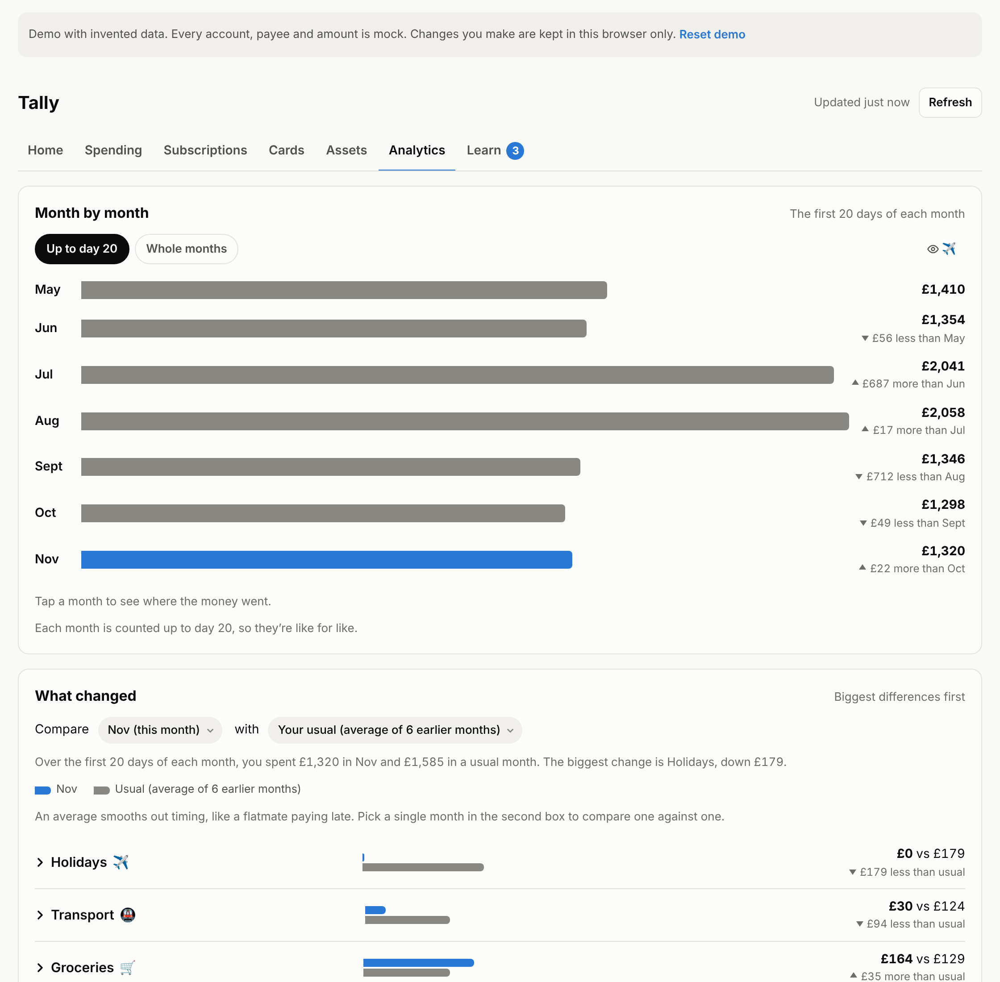

# Tally

A personal finance dashboard that reads my bank accounts through Open Banking, learns how I actually spend, and keeps what it learns.

**[Try the demo](https://niconemtala.github.io/tally/)** · every account, payee and amount in this repo is invented.



## The problem

Banking apps show transactions. They don't show what I actually spent. My money is spread across several accounts and two credit cards, and every budgeting app I tried got the same things wrong because it only sees the raw lines:

- **Flatmates paying me their rent share** shows up as income, so rent looks three times bigger and income looks inflated.
- **Moving money between my own accounts** gets counted as spending.
- **Family reimbursements** (I pay for something, they pay me back) look like both a cost and a salary.
- **Deliveroo** is one merchant, but half the orders are supermarket shops, not takeaways.
- Anything the bank can't place lands in **"General"** and stays there forever.

The goal: one honest number for what I spent, and an app that gets smarter every time I correct it.

## What it does

| Tab | What it shows |
| --- | --- |
| Home | Net worth, spending pace against a usual month with a month-end projection, cards due, what's coming up |
| Spending | Every category against its budget or usual, with the payments behind it |
| Subscriptions | Grouped by what they do, with billing frequency and a "Cancelled?" check for ones that stopped |
| Cards | Statement, due date and payments for each credit card |
| Assets | What you own and what you're owed (loans to friends, Splitwise) |
| Analytics | Each month against the average of the last six, with a drill-down into what changed |
| Learn | Payees Tally isn't sure about, its guesses with reasons, the rules it has learned, and "What Tally knows" |

### The learning log



Tally groups every payment it couldn't place by payee, guesses with a confidence score, and shows why. If it's confident it files the payment and moves on; if not, it asks once.

Every answer becomes a **rule** (this payee, money in or out, goes in this category) that applies to this month, every past month and every future one. On top of the rules sits **"What Tally knows"**: plain-English facts distilled from my explanations, which are fed into every AI prompt so the guesses improve too.

### Getting to the honest number

- **Netting reimbursements.** Flatmates' rent shares offset the rent I pay; family money is pass-through.
- **Own-money moves left out.** Top-ups, currency conversions and moves into savings never count as spending or income.
- **Deliveroo split in two.** Each payment is matched to its receipt; a supermarket order is Groceries, anything else is Eating Out.
- **Amazon by what was bought.** Payments are matched to the order email, so a phone case lands in Shopping and a present in Gifts.



## How it works

The real Tally runs as a Claude artifact: one HTML file with no build step, which gets three things from the Claude runtime:

| Runtime piece | Used for | In this demo |
| --- | --- | --- |
| `mcp` (connectors) | Emma for balances, transactions and recurring payments via Open Banking; Gmail for receipts; a browser for looking up unknown businesses | Emma answers from [`mock/data.js`](mock/data.js); Gmail and the browser report "not connected" |
| `db` (key-value store) | Rules, facts, budgets, holdings, card details, saved months | An in-browser store seeded from [`data/seed.json`](data/seed.json) and saved to `localStorage` |
| `sample` (a Claude model) | Guessing categories for unknown payees and the "Explain" chat | Switched off; name-based guesses still work |

[`mock/runtime.js`](mock/runtime.js) is the stand-in for that runtime. [`index.html`](index.html) is the app itself, unchanged apart from loading the mock scripts and a demo banner.

```
My banks → Open Banking → Emma → Claude connector → Tally
```

Two design choices worth calling out:

- **Finished months are cached forever.** Emma rate-limits reads, and a finished month doesn't change, so Tally reads each one once, saves it to its own database and never asks again. Only the current month refreshes.
- **A small database, not Notion.** A rule saved locally applies the instant you tap, without a round trip to another service or a second login. The Learn tab is the readable view.

## Run it locally

The page fetches `data/seed.json`, so it needs a static server rather than opening the file directly:

```sh
git clone https://github.com/niconemtala/tally
cd tally
python3 -m http.server 8000
# open http://localhost:8000
```

Anything you teach the demo is kept in your browser. Press **Reset demo** at the top to start over.

## What I learned about APIs

Most of the data I wanted has no front door for individuals:

| Source | Access | Approach |
| --- | --- | --- |
| UK banks | No personal Open Banking keys | Read through Emma's Claude connector |
| Trading 212 | Official API with read-only keys | Planned: a read-only proxy holds the key |
| American Express | No personal API | Read on request from my own signed-in browser |
| Splitwise | API, but no connector | Planned: my own small read-only connector |
| US bank | Not in UK Open Banking | Planned: through Monarch's connector |

The pattern for keyed APIs: the key lives in a tiny serverless function (a Cloudflare Worker) that only allows read requests, never in the page.

## Roadmap

- Splitwise connector: read-only first, then adding expenses with a confirm step
- Trading 212 investments through a read-only proxy
- US accounts through Monarch
- Fixed assets valued over time

## Licence

MIT. See [LICENSE](LICENSE).
